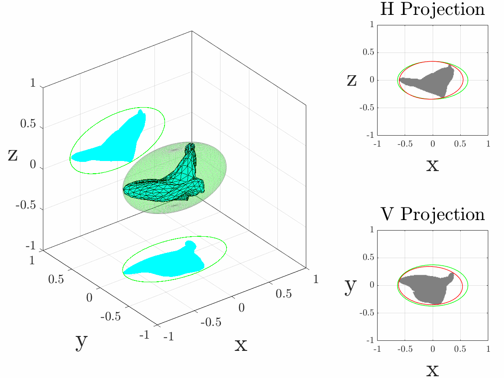
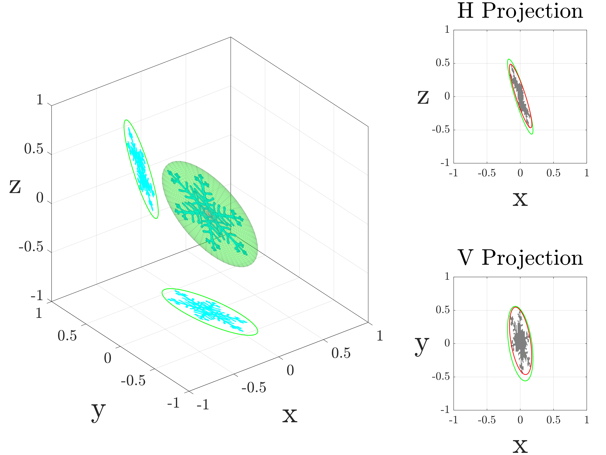

<p align="center">
    
<p>

# IMPACTS_AMT_Study
This repository contains source code, in situ 2D-S measurements, 
and plotting/utilities for the *Atmospheric Measurement Techniques* article
entitled "Universality of ice particle shapes and orientations as revealed by
the 2D-S in situ optical array probe."

## How to generate figures from AMT paper
Figure 6 can be generated with the "plot_habit_fraction_timeseries.m" script, 
Figures 9 and 13 can be generated using the matlab script "IMPACTS_boxchart.m". 
Figures 10, 11, 12, and 14 can be generated directly from "generate_IMPACTS_figures.m".
Comparison ellipse fit joint distributions can be generated    

## How to load and use the ellipse fit data
The ellipse fit data is available in the /Data directory as a .mat file. This data
can be loaded with Matlab
```matlab
load('Data/processed/IMPACTS_EllipseFits_2020_2023.mat')
```
The data can also be read using Python. However, due to the structure format of the 
.mat file, it is easiest to convert the matlab structure to a Python dictionary
using the lightweight pymatreader library which can be installed using either pip

```bash
pip install pymatreader
```

or with conda
```bash
conda install pymatreader
```
The file can then be read in as follows:
```python
from pymatreader import read_mat
m = read_mat('./Data/processed/IMPACTS_EllipseFits_2020_2023.mat')
IMPACTS = m['m']
del m
```
The IMPACTS data is structured as follows:
```text
m/
├── f20200118
├── f20200125
├── f20200201
├── ...
```
where each field starting with "f" represents a separate IOP flight (26 flights/fields in total).

For each flight/field, there are several additional fields corresponding to processing attributes,
measurements from other probes, environmental probe measurements interpolated onto the 2D-S timeseries,
and the 2D-S H/V channel ellipse fit particle-by-particle data. These fields appear as (for example)
```text
f20200220/
├── FCDP
├── P3
├── TwoDS
├── H
├── V
```
"FCDP" has the FCDP bulk size distribution measurements such as liquid water content (LWC)
and number concentration (NT) timeseries. The "P3" field has the environmental parameters measured
onboard the P3 aircraft including for example temperature (Static_Air_Temp) and altitude above mean
sea level (Alt_MSL). The "TwoDS" field has the original H and V channel bulk size distribution parameters 
such as mean volume diameter (Dmv), number concentration (Nt), and ice water content (IWC). The fields
"H" and "V", corresponding to the 2D-S H and V channels, have both the particle-by-particle ellipse fit 
data but also the time-interpolated bulk size distribution, habit fractions, and environmental parameters as well.  

## How to create new STL models

There are two ways to create a new directory of STL models. The first approach is to 
use the "generate_hexagonal.m" Matlab script which creates hexagonal columns with
sizes and aspect ratios governed by a gamma size distribution and various parameterizations,
respectively. The second STL generation method is with the use of the SHPSG library
(SHPSG_IMPACTS.py) which is modified and included in this repository in /STL_models/STL_generation/. 
The easiest way to create a directory of randomly generated "irregular" particles is to run the
"SHPSG_IMPACTS.py" python script and by modifying the parameters and paths in that script. Linux users can activate the OAP_venv virtual environment and then directly
run the script after modifying the IMPACTS_SHPSG.py parameters

```bash
source ./environments/bin/activate
cd ./STL_models/STL_generation
python3 SPSG_IMPACTS.py
```

> [!WARNING]
> SHPSG_IMPACTS.py uses some older scipy functions which might make it difficult to run using more recent scipy versions.

Generating hexagonal prisms (i.e., hexagonal plates or columns) only requires modifying the "generate_hexagonal.m" script
in the /scripts/ directory. Users can easily generate either plates or columns and the power-law parameterization that varies
the aspect ratios with size. This script will generate a directory of STL hexagonal models in the /Simulations/ directory. Alternatively,
single STL hexagonal models can be generated by using the 

```matlab
paths = get_project_paths();
stlDir = paths.stl_models;
stlfile = 'HexColumn_AR10_1.5mm.stl'

aspect_ratio = 10.0 % Creates a hexagonal column with aspect ratio of 10.
Dmax = 1.5; % Resize to 1.5 mm

sobj = gen_stl_hexagonal(aspect_ratio);

sobj = resize_stl_particle(sobj,Dmax);

stlwrite(sobj.particle.TR,fullfile(stlDir,stlfile));
``` 

## How to generate a folder of rotated/projected STL particles


<p align="center">
    
<p>


## How to read simulated STL/ellipsoid models and plot figures
There are two steps to reading in a folder of STL modeled particles. The first
is to read in the folder of STL models with "read_stl_data.m" and the second is to
read a particular particle from that 

```matlab
particle_folder = './Data/Simulation_Dendrite_2/IMPACTS_2020_N2e5_habit/';
stemp = read_stl_data(particle_folder);
```

The output variable (stemp) has the following fields:

```matlab
stemp = 

  struct with fields:

                          index: [1 2 3 4 5 6 7 8 9 10 11 12 13 14 15 16 17 18 19 20 21 22 23 24 25 26 27 28 29 30 31 … ] (1×200000 int32)
                particle_number: [1 1 1 1 1 1 1 1 1 1 1 1 1 1 1 1 1 1 1 1 1 1 1 1 1 1 1 1 1 1 1 1 1 1 1 1 1 1 1 1 1 1 … ] (1×200000 int32)
                              a: [0.5904 0.5904 0.5904 0.5904 0.5904 0.5904 0.5904 0.5904 0.5904 0.5904 0.5904 0.5904 … ] (1×200000 single)
                              b: [0.5661 0.5661 0.5661 0.5661 0.5661 0.5661 0.5661 0.5661 0.5661 0.5661 0.5661 0.5661 … ] (1×200000 single)
                              c: [0.0115 0.0115 0.0115 0.0115 0.0115 0.0115 0.0115 0.0115 0.0115 0.0115 0.0115 0.0115 … ] (1×200000 single)
                            phi: [37.4866 15.2979 8.2082 357.6858 32.0310 12.0434 355.8986 30.8877 17.2062 355.4018 … ] (1×200000 single)
                          theta: [106.1258 101.1994 59.1612 88.0013 124.5449 75.6242 59.9401 72.2828 127.9864 91.8688 … ] (1×200000 single)
                            psi: [5.9043 171.6985 166.2895 179.3659 175.8815 169.8347 1.8885 169.1940 3.3722 163.3182 … ] (1×200000 single)
                        moments: [10×200000 single]
                   surface_area: [0.5688 0.5688 0.5688 0.5688 0.5688 0.5688 0.5688 0.5688 0.5688 0.5688 0.5688 0.5688 … ] (1×200000 single)
                          ra_xy: [0.5735 0.5821 0.5701 0.5901 0.5664 0.5791 0.5662 0.5759 0.5662 0.5903 0.5667 0.5873 … ] (1×200000 single)
                          rb_xy: [0.5568 0.5573 0.4890 0.5660 0.4848 0.5503 0.5107 0.5430 0.4644 0.5421 0.5453 0.5618 … ] (1×200000 single)
                    EllipAng_xy: [74.9118 -4.2029 67.3503 -2.0592 -49.1379 41.0430 -89.0099 69.4643 -79.1705 -7.6243 … ] (1×200000 single)
                          ra_xz: [0.5822 0.5888 0.5901 0.5904 0.5852 0.5894 0.5903 0.5847 0.5891 0.5903 0.5871 0.5903 … ] (1×200000 single)
                          rb_xz: [0.0510 0.1084 0.0933 0.0135 0.2064 0.0699 0.0116 0.0123 0.0721 0.1610 0.0622 0.0698 … ] (1×200000 single)
                    EllipAng_xz: [-16.6297 -8.8608 32.1761 1.9738 -29.0519 16.0203 30.1141 20.6427 -37.6621 -3.1192 … ] (1×200000 single)
                        max_dim: [1 1 1 1 1 1 1 1 1 1 1 1 1 1 1 1 1 1 1 1 1 1 1 1 1 1 1 1 1 1 1 1 1 1 1 1 1 1 1 1 1 1 … ] (1×200000 single)
               particle_area_xy: [0.2164 0.2257 0.2157 0.2102 0.2110 0.2232 0.2099 0.2136 0.2078 0.2173 0.2162 0.2162 … ] (1×200000 single)
               particle_area_xz: [0.0428 0.0758 0.0701 0.0154 0.1218 0.0555 0.0126 0.0133 0.0574 0.0969 0.0507 0.0537 … ] (1×200000 single)
          particle_perimeter_xy: [12.1000 11.2800 9.7800 11.2100 10.1900 11.6800 10.9600 12.0400 9.7200 12.4900 … ] (1×200000 single)
          particle_perimeter_xz: [2.0200 3.2600 2.5000 1.5400 5.0300 2.3000 1.2600 1.3300 2.1000 4.5200 2.1400 2.3100 … ] (1×200000 single)
                   Dmax_xy_cgal: [1.0107 1.0089 1.0255 1.0298 1.0064 1.0347 0.9909 1.0261 0.9905 1.0004 1.0046 1.0286 … ] (1×200000 single)
                  xcirc_xy_cgal: [0.9917 1.0087 1 1 1.0300 1.0050 0.9888 1.0200 1.0150 0.9942 1.0089 0.9900 0.9950 … ] (1×200000 single)
                  ycirc_xy_cgal: [1.0247 0.9724 0.9700 0.9700 1 0.9700 1.0273 0.9700 1.0200 0.9661 0.9703 1.0300 … ] (1×200000 single)
                     ra_xy_cgal: [0.5036 0.5006 0.5163 0.5173 0.5082 0.5135 0.5140 0.5149 0.5103 0.5020 0.5096 0.5130 … ] (1×200000 single)
                     rb_xy_cgal: [0.4779 0.4894 0.4111 0.4927 0.4120 0.4678 0.4308 0.4585 0.3932 0.4842 0.4582 0.4856 … ] (1×200000 single)
               EllipAng_xy_cgal: [-55.2511 -68.2308 70.2622 56.6322 -53.6808 67.0222 -82.4200 -88.3788 -71.5760 … ] (1×200000 single)
                   xpos_xy_cgal: [-0.0065 0.0151 0.0103 0.0116 0.0255 0.0150 0.0103 0.0229 0.0065 0.0054 0.0194 … ] (1×200000 single)
                   ypos_xy_cgal: [0.0332 -0.0207 -0.0179 -0.0122 -0.0139 -0.0193 0.0368 -0.0143 0.0344 -0.0183 … ] (1×200000 single)
                       habit_xy: [200000×1 int32]
                   Dmax_xz_cgal: [0.9949 0.9948 1.0032 0.9908 0.9401 0.9976 1.0048 0.9148 0.9396 0.9800 0.9685 0.9775 … ] (1×200000 single)
                  xcirc_xz_cgal: [0.9850 1.0050 1 1 1.0150 1.0050 1 1.0150 0.9950 0.9950 1.0100 0.9900 1 0.9800 … ] (1×200000 single)
                  ycirc_xz_cgal: [1 1.0050 1.0050 1 1.0050 1.0050 1 1.0050 1 1.0100 1 1 1.0050 1 1.0150 1 1.0050 … ] (1×200000 single)
                     ra_xz_cgal: [0.5135 0.4975 0.4975 0.5319 0.4977 0.4939 0.5413 0.5171 0.5062 0.4994 0.4905 0.5068 … ] (1×200000 single)
                     rb_xz_cgal: [0.0458 0.0952 0.0835 0.0103 0.1845 0.0609 0.0086 0.0100 0.0654 0.1416 0.0580 0.0636 … ] (1×200000 single)
               EllipAng_xz_cgal: [-16.2307 -8.4808 31.6742 1.8896 -28.3468 15.9784 30.1091 20.5502 -36.9784 -3.8900 … ] (1×200000 single)
                   xpos_xz_cgal: [0.0033 0.0154 0.0102 0 0.0274 0.0150 -0.0096 0.0300 0.0039 0.0046 0.0175 0.0133 … ] (1×200000 single)
                   ypos_xz_cgal: [0.0100 0.0143 0.0149 0.0100 0.0112 0.0148 -0.0014 0.0179 0.0104 0.0182 0.0103 … ] (1×200000 single)
                       habit_xz: [200000×1 int32]
                         folder: '/localdata/edunnavan/Simulations/OAP_ellipsoid/Simulation_Dendrite_2/'
                    test_folder: 'IMPACTS_2020_N2e5_habit/'
                        phimean: 0
                      thetamean: 90
                          kappa: 6
                        psimean: 0
                         varpsi: 6
                  area_ratio_xy: [0.2157 0.2214 0.2463 0.2003 0.2446 0.2229 0.2311 0.2174 0.2515 0.2162 0.2227 0.2086 … ] (1×200000 single)
                  area_ratio_xz: [0.4591 0.3779 0.4053 0.6156 0.3210 0.4288 0.5850 0.5908 0.4299 0.3246 0.4420 0.4150 … ] (1×200000 single)
             area_ratio_xy_cgal: [0.2862 0.2932 0.3235 0.2625 0.3208 0.2958 0.3018 0.2880 0.3296 0.2846 0.2948 0.2762 … ] (1×200000 single)
             area_ratio_xz_cgal: [0.5793 0.5095 0.5373 0.8921 0.4222 0.5878 0.8575 0.8170 0.5521 0.4363 0.5676 0.5306 … ] (1×200000 single)
                         Sellip: [2.1037 2.1037 2.1037 2.1037 2.1037 2.1037 2.1037 2.1037 2.1037 2.1037 2.1037 2.1037 … ] (1×200000 single)
                         Vellip: [0.0161 0.0161 0.0161 0.0161 0.0161 0.0161 0.0161 0.0161 0.0161 0.0161 0.0161 0.0161 … ] (1×200000 single)
           ellipse_perimeter_xy: [3.3771 3.3772 3.0639 3.4299 3.0405 3.3360 3.1348 3.2951 2.9748 3.3090 3.3044 3.4043 … ] (1×200000 single)
                ellipse_area_xy: [1.0033 1.0192 0.8759 1.0493 0.8627 1.0011 0.9083 0.9825 0.8262 1.0053 0.9709 1.0365 … ] (1×200000 single)
           ellipse_perimeter_xz: [2.3451 2.4142 2.4061 2.3631 2.5139 2.3857 2.3625 2.3401 2.3859 2.4752 2.3714 2.3892 … ] (1×200000 single)
                ellipse_area_xz: [0.0932 0.2006 0.1729 0.0250 0.3794 0.1294 0.0215 0.0225 0.1335 0.2985 0.1147 0.1294 … ] (1×200000 single)
      ellipse_perimeter_xy_cgal: [2.8978 2.9731 2.6760 2.9863 2.6553 2.8622 2.7290 2.8276 2.6083 2.9343 2.8157 2.9454 … ] (1×200000 single)
           ellipse_area_xy_cgal: [0.7561 0.7697 0.6669 0.8007 0.6578 0.7546 0.6956 0.7416 0.6304 0.7636 0.7335 0.7827 … ] (1×200000 single)
      ellipse_perimeter_xz_cgal: [2.0689 2.0433 2.0326 2.1286 2.1505 2.0006 2.1659 2.0695 2.0528 2.1005 1.9851 2.0537 … ] (1×200000 single)
           ellipse_area_xz_cgal: [0.0739 0.1488 0.1305 0.0173 0.2885 0.0944 0.0147 0.0163 0.1040 0.2221 0.0893 0.1012 … ] (1×200000 single)
                         volume: [0.0021 0.0021 0.0021 0.0021 0.0021 0.0021 0.0021 0.0021 0.0021 0.0021 0.0021 0.0021 … ] (1×200000 single)
                     sphericity: [0.1378 0.1378 0.1378 0.1378 0.1378 0.1378 0.1378 0.1378 0.1378 0.1378 0.1378 0.1378 … ] (1×200000 single)
           ellipsoid_sphericity: [0.1465 0.1465 0.1465 0.1465 0.1465 0.1465 0.1465 0.1465 0.1465 0.1465 0.1465 0.1465 … ] (1×200000 single)
             ellipsoidity_ratio: [0.9407 0.9407 0.9407 0.9407 0.9407 0.9407 0.9407 0.9407 0.9407 0.9407 0.9407 0.9407 … ] (1×200000 single)
              effective_density: [0.1283 0.1283 0.1283 0.1283 0.1283 0.1283 0.1283 0.1283 0.1283 0.1283 0.1283 0.1283 … ] (1×200000 single)
                 effective_area: [0.2704 0.2704 0.2704 0.2704 0.2704 0.2704 0.2704 0.2704 0.2704 0.2704 0.2704 0.2704 … ] (1×200000 single)
                 circularity_xy: [0.0186 0.0223 0.0283 0.0210 0.0255 0.0206 0.0220 0.0185 0.0276 0.0175 0.0195 0.0197 … ] (1×200000 single)
                 circularity_xz: [0.1318 0.0896 0.1409 0.0816 0.0605 0.1318 0.0997 0.0945 0.1636 0.0596 0.1391 0.1265 … ] (1×200000 single)
         circularity_ellipse_xy: [1.1055 1.1229 1.1725 1.1208 1.1727 1.1305 1.1615 1.1371 1.1732 1.1537 1.1174 1.1239 … ] (1×200000 single)
         circularity_ellipse_xz: [0.2130 0.4324 0.3754 0.0563 0.7544 0.2857 0.0485 0.0517 0.2947 0.6123 0.2563 0.2849 … ] (1×200000 single)
    circularity_ellipse_xy_cgal: [1.1315 1.0942 1.1702 1.1282 1.1723 1.1576 1.1737 1.1656 1.1644 1.1145 1.1626 1.1338 … ] (1×200000 single)
    circularity_ellipse_xz_cgal: [0.2169 0.4477 0.3968 0.0479 0.7839 0.2965 0.0394 0.0478 0.3100 0.6326 0.2848 0.3015 … ] (1×200000 single)
                 ellipticity_xy: [0.0168 0.0199 0.0242 0.0188 0.0218 0.0182 0.0189 0.0163 0.0236 0.0152 0.0175 0.0176 … ] (1×200000 single)
                 ellipticity_xz: [0.6188 0.2073 0.3755 1.4495 0.0802 0.4614 2.0566 1.8290 0.5550 0.0973 0.5427 0.4439 … ] (1×200000 single)
            ellipticity_xy_cgal: [0.0164 0.0204 0.0242 0.0186 0.0218 0.0178 0.0187 0.0159 0.0237 0.0157 0.0168 0.0174 … ] (1×200000 single)
            ellipticity_xz_cgal: [0.6077 0.2002 0.3552 1.7042 0.0772 0.4447 2.5338 1.9781 0.5275 0.0942 0.4884 0.4194 … ] (1×200000 single)
                  complexity_xy: [314.2101 265.2911 220.0529 267.5785 243.3744 288.5952 275.1035 316.4425 228.0213 … ] (1×200000 single)
                  complexity_xz: [64.5998 86.1952 56.7634 120.8305 117.6928 62.4163 96.3711 102.2292 50.3768 120.1253 … ] (1×200000 single)
             complexity_xy_cgal: [361.9495 305.2765 252.1926 306.3124 278.7233 332.4080 314.3651 364.2194 261.0408 … ] (1×200000 single)
             complexity_xz_cgal: [72.5623 100.0816 65.3552 145.4523 134.9739 73.0763 116.6779 120.2152 57.0869 … ] (1×200000 single)
```


<p align="center">
    
<p>

## How to produce 2D-S buffer strip images

Buffer strip images with fitted ellipses such as shown in Figure 4 and Figure 8
can be generated with the "select_Hydroviewer_full.py" python code in 
/scripts/Hydroviewer/. Please note that only a sample set of netcdf 2D-S diode files
are included in /Data/sample_raw/. To generate buffer strips based on particle criteria,
users can use the virtual environment in environments/OAP_images_venv.
```bash
source environments/OAP_images_venv/bin/activate
```
Then, users can generate buffer strips by using inline commands with python

```python
python3 selectHydroViewer_full.py 20230113 2DS V 000000 235959 48 0.5 5.0 0.1 1.0 0.4 1.0 -90 90 1e-5 all 1 0
```
