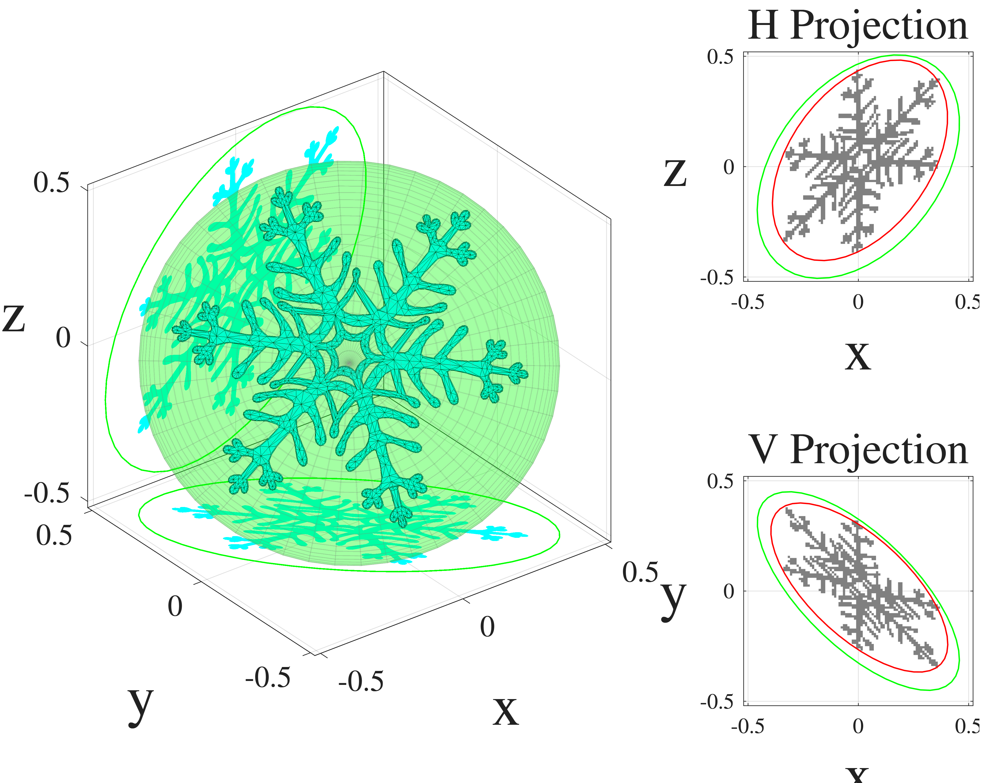

<p align="center">
    
<p>

# IMPACTS_AMT_Study
This repository contains source code, in situ 2D-S measurements, 
and plotting/utilities for the *Atmospheric Measurement Techniques* article
entitled "Universality of ice particle shapes, densities, and orientations as revealed by
the 2D-S in situ optical array probe."

## Prerequisites 
Once this repository is cloned or downloaded onto a local computer, users will need
to download the following two additional files and put them in the proper folder locations in
the Git `IMPACTS_AMT_Study` directory. 

### 1. IMPACTS ellipse data

[IMPACTS 2020, 2022, and 2023 ellipse fit .mat file](https://zenodo.org/records/19338927)

Users will need to download the above Zenodo .mat file and put it in `/Data/processed/`.

> [!IMPORTANT]
> If users would like to run the STL projection simulations themselves, which use the CGAL library 
 for the 2D ellipse fitting, then they will have
to install the [CGAL library](https://www.cgal.org/) onto their machines and 
compile the C++ files: CGAL_Ellipse_UIOPS.cpp and CGAL_minR.cpp in `/src/mex_source/`. 
Instructions for compiling the Mex files can be found on the [Mathworks website](https://www.mathworks.com/help/matlab/matlab_external/build-c-mex-programs.html).
See below for instructions on how to install these libraries on different operating systems.

### 2. STL projection Monte Carlo simulation data
[STL projection simulation data](https://zenodo.org/records/23930290)

Users will need to download and unzip the above folder. Each folder (e.g., `CappedColumns_10k/`)
will need to go into a parent folder called `Simulations/` which is at the parent
level of the Git repository (at the same level as `/Data/`, `/scripts/`, etc.).


## Running scripts/functions

`IMPACTS_AMT_Study` is set up to be completely self contained. If running Matlab scripts in `/scripts/` or any source code in `/src/`,
users just need to call `init_project.m`

```matlab
paths = init_project();
```
This provides the required paths (relative to `IMPACTS_AMT_Study`) 

```matlab
>> paths = init_project();
>> paths

paths = 

  struct with fields:

            root: 'C:\Users\edwin.dunnavan\Documents\IMPACTS_AMT_Study'
             src: 'C:\Users\edwin.dunnavan\Documents\IMPACTS_AMT_Study\src'
           utils: 'C:\Users\edwin.dunnavan\Documents\IMPACTS_AMT_Study\src\utils'
            data: 'C:\Users\edwin.dunnavan\Documents\IMPACTS_AMT_Study\Data\processed'
          sample: 'C:\Users\edwin.dunnavan\Documents\IMPACTS_AMT_Study\Data\sample_raw'
         figures: 'C:\Users\edwin.dunnavan\Documents\IMPACTS_AMT_Study\Figures'
     simulations: 'C:\Users\edwin.dunnavan\Documents\IMPACTS_AMT_Study\Simulations'
      stl_models: 'C:\Users\edwin.dunnavan\Documents\IMPACTS_AMT_Study\STL_models'
         scripts: 'C:\Users\edwin.dunnavan\Documents\IMPACTS_AMT_Study\scripts'
    ellipse_file: 'C:\Users\edwin.dunnavan\Documents\IMPACTS_AMT_Study\Data\processed\IMPACTS_EllipseFits_2020_2023.mat'
```


## 🛠️ CGAL Build & Installation Guide

This project relies on **CGAL** and **Boost** libraries. 

Ensure you have the following installed on your system:
* **MATLAB** (with a supported C++ compiler configured via `mex -setup cpp`).
* **Git** (If you use Anaconda/Miniconda, ensure your Conda environment with Git is activated).


This repository contains C++ MEX files that utilize the **CGAL** and **Boost** geometry frameworks. 

To make compilation painless and identical across different machines, dependencies are isolated locally inside the project using `vcpkg` in Manifest Mode. This prevents libraries from muddying your global system path variables.

---

> [!IMPORTANT]
> Ensure your local project directory path **does not contain any spaces** (e.g., use `C:\src\IMPACTS_AMT_Study\` instead of `C:\Users\Name\My Documents\Project Files\`). Spaces in the directory path will cause internal parsing crashes in the underlying CMake/Ninja build utilities.

---

## Step 1: Install CGAL/BOOST libraries

### Windows:

MATLAB requires an officially integrated compiler environment to build MEX binaries. Download and install the official package directly from the MathWorks website:
   **[MATLAB Support for MinGW-w64 C/C++ Compiler](https://www.mathworks.com/matlabcentral/fileexchange/52848-matlab-support-for-mingw-w64-c-c-fortran-compiler)**
   
   *Once installed, verify that MATLAB detects it by typing `mex -setup cpp` in the MATLAB Command Window.*

If you use Anaconda or Miniconda, ensure you open your **Anaconda Prompt** or **Anaconda PowerShell Prompt** for the next step so the `git` command is actively recognized. 
Open your terminal (e.g., Anaconda PowerShell Prompt), navigate to your space-free project root directory, and execute the following commands to pull down and compile the math and geometry dependencies locally:

```bash
# 1. Clone the vcpkg package manager framework natively
git clone https://github.com vcpkg

# 2. Bootstrap the internal executable environment
cd vcpkg
.\bootstrap-vcpkg.bat
cd ..

# 3. Download and build the exact CGAL & multi-precision binary packages
.\vcpkg\vcpkg install --triplet=x64-mingw-dynamic --host-triplet=x64-mingw-dynamic
```

*This will automatically generate a localized `vcpkg_installed/` directory inside your project root, packed with your required calculation headers and compiled math binaries.*

> [!CAUTION]
> The `vcpkg` package is quite large (> 1 GB) and can take quite a while to install into `/IMPACTS_AMT_study/`. On a Windows 11 laptop, it takes longer than 40 minutes to install everything.

### Linux (Using Ubuntu/Debian)
Update your standard apt-cache registries and install the development headers directly:
```bash
sudo apt update
sudo apt install build-essential libcgal-dev libgmp-dev libmpfr-dev
```

### MacOS (Using Homebrew)
1. Ensure you have the command line developer utilities set up:
   ```bash
   xcode-select --install
   ```
2. Install the required calculation and structural libraries via **[Homebrew](https://brew.sh)**:
   ```bash
   brew install cgal gmp mpfr
   ```
---

### Step 2: Run the Automated MEX Compiler

Both `CGAL_EllipseSize_UIOPS.cpp` and `CGAL_minR.cpp` require linking against the local compiled mathematical libraries (`GMP`/`MPFR`) and mapping legacy header endpoints. This pipeline has been entirely automated.

1. Open MATLAB.
2. Set your **Current Folder** to the project root directory.
3. In the MATLAB Command Window, simply run the compilation script:
   ```matlab
   compile_mex
   ```
`compile_mex.m` will automatically track down the Window's MinGW-w64 C/C++ Compiler, your Homebrew prefixes (`/opt/homebrew` on Apple Silicon or `/usr/local` on Intel architectures) or your standard Linux `/usr/include` branches, bind your mathematical dependency flags, and output your compilation modules:
* `src/mex_source/CGAL_EllipseSize_UIOPS.mexa64` (Linux) or `.mexmaca64` (Mac)
* `src/mex_source/CGAL_minR.mexa64` (Linux) or `.mexmaca64` (Mac)

Matlab's command window will show the following message if the mex files were successfully compiled:

```matlab 
===================================================
🎉 [SUCCESS] All MEX binaries successfully generated in source tree!
===================================================
``` 

The `/tests/Ellipse_CGAL_test.m` matlab script can be used to test the installation of 
the CGAL ellipse fitting code.

---

## How to generate figures from AMT paper
Matlab scripts in the `/scripts/` directory are meant to for readers to generate 
the figures in the paper but can also serve in general way to produce observation and
simulation results. The table below shows what scripts need to be run to reproduce which figure. Note that some scripts
such as `/scripts/plot_habit_fraction_timeseries.m` will reproduce the exact habit timeseries plot (Figure 6)
as in the AMT manuscript but other scripts such as `/scripts/generate_stacked_joint_distributions.m` require
modifying the script parameters to generate certain figures.

<div align="center">

| Figure Number | Matlab Script Name
| :---: | :---: |
| 1 | N/A |
| 2 | singleellipsoidprojection-1.0.0.mltbx or [SingleEllipsoidProjection Matlab App](https://www.mathworks.com/matlabcentral/fileexchange/157571-singleellipsoidprojection)|
| 3 | plot_fisher_density.m |
| 4 | plot_example_stl.m and read_simulated_particles.m |
| 5 | N/A |
| 6 | plot_habit_fraction_timeseries.m |
| 7 | N/A |
| 8 | N/A; generated with selectHydroViewer_full.py in /scripts/HydroViewer/|
| 9 | IMPACTS_heatmaps.m |
| 10 | IMPACTS_boxchart.m |
| 11 | generate_joint_ellipse_cases.m |
| 12 | generate_joint_ellipse_cases.m |
| 13 | generate_ar_ang_temp_lvls.m |
| 14 | generate_stacked_joint_distributions.m |
| 15 | generate_stacked_joint_distributions.m |
| 16 | plot_mmd_bootstrapped_boxplots.m |
| 17 | generate_ellipsoid_sim_projections.m |
| 18 | generate_stacked_joint_distributions.m |
| 19 | generate_stacked_joint_distributions.m |
| 20 | generate_stacked_joint_distributions.m |
| 21 | habit_3d_2d_boxplot.m |
| B1 | IMPACTS_hist_angle_comp_CH.m |

</div>

The median relative difference percentages and two-sample Kolmogorov-Smirnov test results presented in section 3 of the 
paper can be calculated by running `/scripts/IMPACTS_KS_test.m`.

## How to load and use the ellipse fit data
Once the ellipse fit data is downloaded from [Zenodo](https://zenodo.org/records/19338927) and put 
into the `/Data/processed/` folder, users can load this data
using Matlab by simply using the load function
```matlab
load('./Data/processed/IMPACTS_EllipseFits_2020_2023.mat')
```
The data can also be read using Python. However, due to the structure format of the 
.mat file, it is easiest to convert the matlab structure to a Python dictionary
using the lightweight [pymatreader](https://pypi.org/project/pymatreader/) library which can be installed using either pip

```bash
pip install pymatreader
```

or with conda
```bash
conda install pymatreader
```
The file can then be read in as follows:
```python
from pymatreader import read_mat
m = read_mat('./Data/processed/IMPACTS_EllipseFits_2020_2023.mat')
IMPACTS = m['m']
del m
```
The IMPACTS data is structured as follows:
```text
m/
├── f20200118
├── f20200125
├── f20200201
├── ...
```
where each field starting with "f" represents a separate IOP flight (26 flights/fields in total).

For each flight/field, there are several additional fields corresponding to processing attributes,
measurements from other probes, environmental probe measurements interpolated onto the 2D-S timeseries,
and the 2D-S H/V channel ellipse fit particle-by-particle data. These fields appear as (for example)
```text
f20200220/
├── FCDP
├── P3
├── TwoDS
├── H
├── V
```
"FCDP" has the FCDP bulk size distribution measurements such as liquid water content (LWC)
and number concentration (NT) timeseries. The "P3" field has the environmental parameters measured
onboard the P3 aircraft including for example temperature (Static_Air_Temp) and altitude above mean
sea level (Alt_MSL). The "TwoDS" field has the original H and V channel bulk size distribution parameters 
such as mean volume diameter (Dmv), number concentration (Nt), and ice water content (IWC). The fields
"H" and "V", corresponding to the 2D-S H and V channels, have both the particle-by-particle ellipse fit 
data but also the time-interpolated bulk size distribution, habit fractions, and environmental parameters as well.  

## How to create new STL models

There are two ways to create a new directory of STL models. The first approach is to 
use the `/scripts/generate_hexagonal.m` Matlab script which creates hexagonal columns with
sizes and aspect ratios governed by a gamma size distribution and various parameterizations,
respectively. The second STL generation method is with the use of the SHPSG library
The easiest way to create a directory of randomly generated "irregular" particles is to run the
`/STL_models/STL_generation/SHPSG_IMPACTS.py` python script and by modifying the parameters and paths in that script.

Generating hexagonal prisms (i.e., hexagonal plates or columns) only requires modifying the `/scripts/generate_hexagonal.m` script. 
Users can easily generate either plates or columns and the power-law parameterization that varies
the aspect ratios with size. This script will generate a directory of STL hexagonal models in the `/Simulations/` directory. Alternatively,
single STL hexagonal models can be generated by using the stlwrite function directly after generating and resizeing the individual stl
hexagonal prism as follows:

```matlab
paths = get_project_paths();
stlDir = paths.stl_models;
stlfile = 'HexColumn_AR10_1.5mm.stl'

aspect_ratio = 10.0 % Creates a hexagonal column with aspect ratio of 10.
Dmax = 1.5; % Resize to 1.5 mm

sobj = gen_stl_hexagonal(aspect_ratio);

sobj = resize_stl_particle(sobj,Dmax);

stlwrite(sobj.particle.TR,fullfile(stlDir,stlfile));
``` 

## How to generate a folder of rotated/projected STL particles

<p align="center">
    
<p>

To generate a folder of rotated and projected STL particles, users can run
`/scripts/generate_STL_projections.m`. This script
is essentially a wrapper for the `/src/core_physics/simulate_stl_particles.m` function which takes a directory
of STL models and performs the Monte Carlo rotations and projections based upon configurations
provided in the config structure. Users need to provide the directory location of the STL
files, the name of the test directory that will be created which provides the netcdf results,
and the configuration parameters for the Monte Carlo simulation. The `/scripts/generate_STL_projections.m`
script has each STL test set of configurations in commented blocks such that users only need to
uncomment one of the STL projection simulation tests used in the manuscript. 

> [!IMPORTANT]
> **Each folder MUST contain a set of files named `particle_*_orig.stl` where *
represents a number 1 through the total number of STL models you want to project.**

## How to read simulated STL/ellipsoid models and plot figures
There are two steps to reading in a folder of STL modeled particles. The first
step is to read in the folder of STL models with `read_stl_data.m`. The Github directory
has an example Monte Carlo projection simulation using the `snowflake.stl` STL model.
These example simulations do not use the 2D-S synthetic filtering so any particle can be plotted.
Reading in the folder simply involves passing the particle folder into read_stl_data:

```matlab
paths = init_project();
sim_dir = paths.simulations;
particle_folder = fullfile(sim_dir,'Dendrite_Example/Random_100/');
stemp = read_stl_data(particle_folder);
```

The output variable (stemp) has the following fields:

```matlab
stemp

stemp = 

  struct with fields:

                          index: [1 2 3 4 5 6 7 8 9 10 11 12 13 14 15 16 17 18 19 20 21 22 23 24 25 26 27 28 29 30 31 32 33 34 35 36 37 38 39 40 41 … ] (1×100 int32)
                particle_number: [1 1 1 1 1 1 1 1 1 1 1 1 1 1 1 1 1 1 1 1 1 1 1 1 1 1 1 1 1 1 1 1 1 1 1 1 1 1 1 1 1 1 1 1 1 1 1 1 1 1 1 1 1 1 1 1 1 … ] (1×100 int32)
                              a: [0.5904 0.5904 0.5904 0.5904 0.5904 0.5904 0.5904 0.5904 0.5904 0.5904 0.5904 0.5904 0.5904 0.5904 0.5904 0.5904 … ] (1×100 single)
                              b: [0.5661 0.5661 0.5661 0.5661 0.5661 0.5661 0.5661 0.5661 0.5661 0.5661 0.5661 0.5661 0.5661 0.5661 0.5661 0.5661 … ] (1×100 single)
                              c: [0.0115 0.0115 0.0115 0.0115 0.0115 0.0115 0.0115 0.0115 0.0115 0.0115 0.0115 0.0115 0.0115 0.0115 0.0115 0.0115 … ] (1×100 single)
                            phi: [33.3678 136.7952 261.8414 64.1328 223.4296 275.8936 48.1632 13.9999 74.2020 30.7381 251.1932 342.8094 274.7289 … ] (1×100 single)
                          theta: [139.9822 92.4698 148.6290 72.0151 134.9981 80.9807 66.1934 135.5288 23.4954 176.1964 38.4153 88.1336 31.2954 … ] (1×100 single)
                            psi: [27.6012 116.5871 103.0316 171.4278 94.9780 176.1662 145.8445 77.7538 86.6384 4.6891 91.4455 60.1633 101.1759 … ] (1×100 single)
                        moments: [10×100 single]
                   surface_area: [0.5688 0.5688 0.5688 0.5688 0.5688 0.5688 0.5688 0.5688 0.5688 0.5688 0.5688 0.5688 0.5688 0.5688 0.5688 0.5688 … ] (1×100 single)
                          ra_xy: [0.5695 0.5904 0.5725 0.5739 0.5783 0.5836 0.5819 0.5779 0.5700 0.5661 0.5756 0.5904 0.5726 0.5898 0.5820 0.5806 … ] (1×100 single)
                          rb_xy: [0.3346 0.2533 0.0695 0.5478 0.0373 0.5643 0.4350 0.0867 0.0179 0.0407 0.0147 0.2817 0.0599 0.2701 0.0310 0.0178 … ] (1×100 single)
                    EllipAng_xy: [87.5846 -44.3165 70.9204 -73.5478 40.0539 -75.2860 74.9258 22.4374 71.1610 -63.9631 72.2887 -18.1491 -75.9090 … ] (1×100 single)
                          ra_xz: [0.5874 0.5715 0.5833 0.5719 0.5774 0.5663 0.5791 0.5874 0.5865 0.5904 0.5813 0.5847 0.5836 0.5726 0.5832 0.5761 … ] (1×100 single)
                          rb_xz: [0.0139 0.3736 0.1887 0.1231 0.4433 0.0965 0.0734 0.5187 0.1847 0.2482 0.1749 0.4710 0.1413 0.4404 0.5648 0.0222 … ] (1×100 single)
                    EllipAng_xz: [-55.2357 52.2272 -83.6559 16.3263 -89.0114 -2.8524 39.9504 -61.4590 -89.2086 -85.8748 -88.2833 23.7108 -84.5968 … ] (1×100 single)
                        max_dim: [1 1 1 1 1 1 1 1 1 1 1 1 1 1 1 1 1 1 1 1 1 1 1 1 1 1 1 1 1 1 1 1 1 1 1 1 1 1 1 1 1 1 1 1 1 1 1 1 1 1 1 1 1 1 1 1 … ] (1×100 single)
               particle_area_xy: [0.1396 0.1179 0.0537 0.1925 0.0341 0.1941 0.1689 0.0610 0.0193 0.0353 0.0165 0.1285 0.0475 0.1235 0.0294 0.0197 … ] (1×100 single)
               particle_area_xz: [0.0155 0.1525 0.0968 0.0748 0.1720 0.0639 0.0546 0.1893 0.0958 0.1165 0.0920 0.1821 0.0803 0.1716 0.1930 0.0233 … ] (1×100 single)
          particle_perimeter_xy: [10.0400 8.9300 2.5200 14.0500 1.7800 13.7000 11.9200 3.5500 1.6400 1.8800 1.5800 9.5000 2.2500 9.3600 1.8900 … ] (1×100 single)
          particle_perimeter_xz: [1.4300 11.2200 7.4700 5.2900 12.1500 3.5800 2.5700 13.8700 7.4500 8.8000 6.9200 12.7400 6.0300 12.1500 13.6800 … ] (1×100 single)
                   Dmax_xy_cgal: [1.0002 1.0004 0.9908 1.0304 0.9143 1.0334 1.0208 0.9134 0.9808 0.9452 1.0283 0.9972 1.0166 1.0032 1.0014 0.9902 … ] (1×100 single)
                  xcirc_xy_cgal: [0 0 -0.0200 0.0200 -0.0350 -0.0450 0 0.0150 -0.0150 -0.0150 -0.0050 -0.0100 -0.0150 0 -0.0300 -0.0100 0.0050 … ] (1×100 single)
                  ycirc_xy_cgal: [0.0150 0 -0.0400 -0.0250 -0.0300 -0.0150 -0.0350 0 -0.0300 0.0050 0.0150 0.0050 0.0100 -0.0250 -0.0150 -0.0300 … ] (1×100 single)
                     ra_xy_cgal: [0.4967 0.5071 0.4954 0.5166 0.4956 0.5145 0.5108 0.4872 0.5023 0.4956 0.5292 0.5058 0.5111 0.5012 0.5100 0.4981 … ] (1×100 single)
                     rb_xy_cgal: [0.2924 0.2255 0.0629 0.4656 0.0353 0.4848 0.3734 0.0770 0.0177 0.0354 0.0124 0.2510 0.0526 0.2411 0.0293 0.0156 … ] (1×100 single)
               EllipAng_xy_cgal: [-88.3999 -43.1050 70.7454 -51.5284 40.0955 -27.1248 81.8372 22.6682 71.1685 -64.0364 72.2383 -18.8937 -75.7630 … ] (1×100 single)
                   xpos_xy_cgal: [-0.0039 0.0043 -0.0109 0.0240 -0.0213 -0.0288 0.0138 0.0152 -0.0029 -0.0100 0.0031 0.0052 -0.0071 0.0115 -0.0149 … ] (1×100 single)
                   ypos_xy_cgal: [0.0265 0.0158 -0.0279 -0.0143 -0.0157 -7.7523e-05 -0.0223 0.0093 -0.0102 0.0200 0.0131 0.0156 0.0222 -0.0096 … ] (1×100 single)
                       habit_xy: [100×1 int32]
                   Dmax_xz_cgal: [0.9005 1.0214 0.9851 1.0092 1.0370 0.9068 0.9083 1.0112 0.9534 0.9901 0.8845 0.9802 0.9201 1.0036 1.0190 0.9402 … ] (1×100 single)
                  xcirc_xz_cgal: [-0.0150 0 -0.0200 0.0150 -0.0300 -0.0250 0.0150 0.0050 -0.0200 -0.0250 0.0268 -0.0100 -0.0150 0.0200 -0.0304 … ] (1×100 single)
                  ycirc_xz_cgal: [0.0050 0.0150 0.0050 0 0.0100 -0.0050 0.0100 0.0100 0 -0.0100 0.0140 0.0200 0.0050 0 0.0083 0.0250 0.0150 0 0 … ] (1×100 single)
                     ra_xz_cgal: [0.5165 0.5128 0.5126 0.5050 0.5136 0.4980 0.4861 0.5091 0.4913 0.4964 0.4976 0.4970 0.5008 0.4987 0.5126 0.5179 … ] (1×100 single)
                     rb_xz_cgal: [0.0119 0.3174 0.1631 0.1076 0.3775 0.0821 0.0667 0.4480 0.1638 0.2217 0.1548 0.4207 0.1250 0.3813 0.4858 0.0166 … ] (1×100 single)
               EllipAng_xz_cgal: [-55.3335 53.8136 -83.2135 15.5543 -84.5768 -2.4401 40.3851 -75.7347 -89.3200 -84.8097 -88.8692 26.8826 -84.2414 … ] (1×100 single)
                   xpos_xz_cgal: [-0.0071 0.0075 -0.0109 0.0226 -0.0179 -0.0254 0.0161 0.0153 -0.0054 -0.0108 0.0050 0.0022 -0.0067 0.0089 -0.0147 … ] (1×100 single)
                   ypos_xz_cgal: [0.0111 0.0286 0.0138 0.0022 0.0203 0.0020 0.0164 0.0178 0.0082 -0.0013 0.0210 0.0280 0.0222 0.0263 0.0147 … ] (1×100 single)
                       habit_xz: [100×1 int32]
                     grid_bound: [0.6000 9.9692e+36 9.9692e+36 9.9692e+36 9.9692e+36 9.9692e+36 0.5900 9.9692e+36 9.9692e+36 9.9692e+36 9.9692e+36 … ] (1×100 single)
                         folder: 'C:\Users\edwin.dunnavan\Documents\IMPACTS_AMT_Study\Simulations\Dendrite_Example'
                    test_folder: 'Random_100_TEST2'
                        phimean: 0
                      thetamean: 90
                          kappa: 0.0010
                        psimean: 0
                         varpsi: 0.0010
                     fill_holes: 0
                  area_ratio_xy: [0.2332 0.2509 0.4298 0.1949 0.5036 0.1876 0.2124 0.3876 0.6026 0.4879 0.6224 0.2460 0.4411 0.2467 0.5182 0.6070 … ] (1×100 single)
                  area_ratio_xz: [0.6055 0.2274 0.2799 0.3383 0.2139 0.3720 0.4089 0.1978 0.2815 0.2531 0.2881 0.2105 0.3100 0.2166 0.1865 0.5805 … ] (1×100 single)
             area_ratio_xy_cgal: [0.3059 0.3281 0.5489 0.2547 0.6208 0.2477 0.2819 0.5179 0.6917 0.6398 0.7995 0.3222 0.5621 0.3253 0.6272 0.8048 … ] (1×100 single)
             area_ratio_xz_cgal: [0.8060 0.2982 0.3685 0.4381 0.2824 0.4975 0.5361 0.2642 0.3789 0.3370 0.3801 0.2772 0.4083 0.2873 0.2467 0.8600 … ] (1×100 single)
                         Sellip: [2.1037 2.1037 2.1037 2.1037 2.1037 2.1037 2.1037 2.1037 2.1037 2.1037 2.1037 2.1037 2.1037 2.1037 2.1037 2.1037 … ] (1×100 single)
                         Vellip: [0.0161 0.0161 0.0161 0.0161 0.0161 0.0161 0.0161 0.0161 0.0161 0.0161 0.0161 0.0161 0.0161 0.0161 0.0161 0.0161 … ] (1×100 single)
           ellipse_perimeter_xy: [2.6701 2.6027 2.3184 3.3197 2.3229 3.4208 2.9386 2.3525 2.2827 2.2756 2.3042 2.6488 2.3121 2.6275 2.3350 2.3251 … ] (1×100 single)
                ellipse_area_xy: [0.5985 0.4699 0.1249 0.9875 0.0677 1.0347 0.7951 0.1574 0.0320 0.0724 0.0265 0.5224 0.1077 0.5005 0.0567 0.0325 … ] (1×100 single)
           ellipse_perimeter_xz: [2.3512 2.7587 2.4829 2.3621 2.9467 2.3151 2.3472 3.2094 2.4899 2.5946 2.4575 3.0461 2.4270 2.9244 3.4241 2.3083 … ] (1×100 single)
                ellipse_area_xz: [0.0256 0.6707 0.3458 0.2211 0.8040 0.1718 0.1335 0.9572 0.3403 0.4603 0.3194 0.8651 0.2590 0.7922 1.0348 0.0401 … ] (1×100 single)
      ellipse_perimeter_xy_cgal: [2.3303 2.2482 2.0079 2.8590 1.9921 2.9422 2.5581 1.9864 2.0119 1.9924 2.1184 2.2857 2.0633 2.2521 2.0467 1.9947 … ] (1×100 single)
           ellipse_area_xy_cgal: [0.4563 0.3593 0.0978 0.7557 0.0549 0.7836 0.5991 0.1178 0.0279 0.0552 0.0206 0.3988 0.0845 0.3796 0.0469 0.0245 … ] (1×100 single)
      ellipse_perimeter_xz_cgal: [2.0672 2.4374 2.1783 2.0849 2.5775 2.0334 1.9742 2.7760 2.0975 2.2022 2.1099 2.6522 2.0867 2.5409 2.9460 2.0743 … ] (1×100 single)
           ellipse_area_xz_cgal: [0.0192 0.5114 0.2627 0.1707 0.6091 0.1285 0.1019 0.7166 0.2528 0.3457 0.2420 0.6568 0.1967 0.5974 0.7824 0.0271 … ] (1×100 single)
                         volume: [0.0021 0.0021 0.0021 0.0021 0.0021 0.0021 0.0021 0.0021 0.0021 0.0021 0.0021 0.0021 0.0021 0.0021 0.0021 0.0021 … ] (1×100 single)
                     sphericity: [0.1378 0.1378 0.1378 0.1378 0.1378 0.1378 0.1378 0.1378 0.1378 0.1378 0.1378 0.1378 0.1378 0.1378 0.1378 0.1378 … ] (1×100 single)
           ellipsoid_sphericity: [0.1465 0.1465 0.1465 0.1465 0.1465 0.1465 0.1465 0.1465 0.1465 0.1465 0.1465 0.1465 0.1465 0.1465 0.1465 0.1465 … ] (1×100 single)
             ellipsoidity_ratio: [0.9407 0.9407 0.9407 0.9407 0.9407 0.9407 0.9407 0.9407 0.9407 0.9407 0.9407 0.9407 0.9407 0.9407 0.9407 0.9407 … ] (1×100 single)
              effective_density: [0.1283 0.1283 0.1283 0.1283 0.1283 0.1283 0.1283 0.1283 0.1283 0.1283 0.1283 0.1283 0.1283 0.1283 0.1283 0.1283 … ] (1×100 single)
                 effective_area: [0.2704 0.2704 0.2704 0.2704 0.2704 0.2704 0.2704 0.2704 0.2704 0.2704 0.2704 0.2704 0.2704 0.2704 0.2704 0.2704 … ] (1×100 single)
                 circularity_xy: [0.0174 0.0186 0.1063 0.0123 0.1352 0.0130 0.0149 0.0608 0.0902 0.1255 0.0831 0.0179 0.1179 0.0177 0.1034 0.0867 … ] (1×100 single)
                 circularity_xz: [0.0953 0.0152 0.0218 0.0336 0.0146 0.0627 0.1039 0.0124 0.0217 0.0189 0.0241 0.0141 0.0278 0.0146 0.0130 0.0914 … ] (1×100 single)
         circularity_ellipse_xy: [1.0549 0.8717 0.2921 1.1261 0.1577 1.1111 1.1570 0.3573 0.0772 0.1756 0.0627 0.9357 0.2531 0.9111 0.1308 0.0754 … ] (1×100 single)
         circularity_ellipse_xz: [0.0582 1.1075 0.7050 0.4980 1.1636 0.4027 0.3046 1.1678 0.6897 0.8593 0.6645 1.1717 0.5526 1.1640 1.1091 0.0947 … ] (1×100 single)
    circularity_ellipse_xy_cgal: [1.0559 0.8933 0.3049 1.1618 0.1740 1.1375 1.1505 0.3751 0.0866 0.1747 0.0578 0.9592 0.2494 0.9405 0.1406 0.0773 … ] (1×100 single)
    circularity_ellipse_xz_cgal: [0.0565 1.0817 0.6956 0.4936 1.1522 0.3904 0.3284 1.1685 0.7222 0.8958 0.6832 1.1734 0.5676 1.1627 1.1328 0.0791 … ] (1×100 single)
                 ellipticity_xy: [0.0165 0.0213 0.3638 0.0109 0.8576 0.0117 0.0129 0.1702 1.1673 0.7148 1.3238 0.0191 0.4658 0.0194 0.7910 1.1490 … ] (1×100 single)
                 ellipticity_xz: [1.6369 0.0137 0.0309 0.0675 0.0126 0.1556 0.3411 0.0106 0.0314 0.0220 0.0363 0.0120 0.0502 0.0125 0.0117 0.9653 … ] (1×100 single)
            ellipticity_xy_cgal: [0.0165 0.0208 0.3485 0.0105 0.7775 0.0114 0.0130 0.1621 1.0409 0.7185 1.4371 0.0187 0.4727 0.0188 0.7356 1.1212 … ] (1×100 single)
            ellipticity_xz_cgal: [1.6844 0.0141 0.0313 0.0681 0.0127 0.1605 0.3163 0.0106 0.0300 0.0211 0.0353 0.0120 0.0489 0.0126 0.0114 1.1549 … ] (1×100 single)
                  complexity_xy: [348.7274 338.7953 77.5264 452.7494 65.9351 418.8176 387.7314 128.6241 108.1763 69.9352 119.3633 348.3219 70.7822 … ] (1×100 single)
                  complexity_xz: [102.6604 393.6191 304.9723 217.6030 396.9654 122.3349 77.3548 451.9374 307.4039 334.4012 279.3665 408.9210 … ] (1×100 single)
             complexity_xy_cgal: [399.3960 387.4486 87.6165 517.5704 73.2058 481.2519 446.6556 148.6741 115.8981 80.0841 135.2782 398.6852 79.9049 … ] (1×100 single)
             complexity_xz_cgal: [118.4431 450.8062 349.9428 247.6308 456.0764 141.4647 88.5685 522.3181 356.6244 385.8846 320.9235 469.3086 … ] (1×100 single)
```


<p align="center">
    
<p>

To plot the 3D STL particle and ellipsoid along with the H and V projections, 
 users just need to use the plot
```matlab
sobj = read_stl_particle(particle_folder,2);
plot_stl_particle(sobj);
```
Users can also use the `/scripts/plot_example_stl.m` matlab script to generate these
figures as well.

## How to produce 2D-S buffer strip images

Buffer strip images with fitted ellipses such as shown in Figure 4 and Figure 8
can be generated with the `select_Hydroviewer_full.py` python code in 
`/scripts/Hydroviewer/`. Please note that only a sample set of netcdf 2D-S diode files
are included in `/Data/sample_raw/`. Users can generate buffer strips by using inline commands with python

```python
python3 selectHydroViewer_full.py 20230113 2DS V 000000 235959 48 0.5 5.0 0.1 1.0 0.4 1.0 -90 90 1e-5 all 1 0
```
